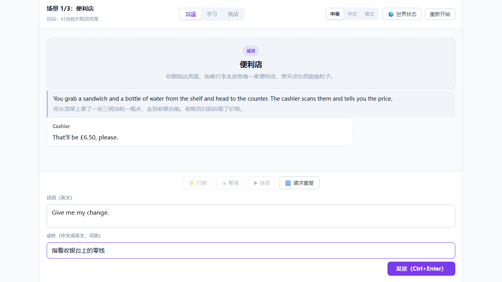

# Virtual-Talking

> **AI 驱动的沉浸式英语表达模拟器**
> 在一个由 AI 运行的小世界里，用真实的英语解决问题——而不是背标准答案。



---

## 这是什么

一款以**连续剧情**为载体的英文表达练习软件。你置身一个虚拟的英国小镇，需要完成安顿下来的各种真实事务：报到注册、银行开户、买生活用品……每一件事都要你自己组织英文去沟通。

不同于背单词软件和跟读课程，这里没有选项按钮，也没有标准答案。你要面对的是「突然置身真实英文场景时说不出话」这个真实的痛点。

**核心原则：**

> AI 不应该只是一个会陪用户聊天的英语老师，而应该是一个**负责运行世界的游戏引擎**。

---

## 它解决什么问题

| 学习方式 | 用户主要做什么 | 主要局限 |
|---|---|---|
| 背单词软件 | 记忆词汇 | 缺乏真实交流语境 |
| 传统口语课程 | 学习固定对话、跟读 | 容易依赖预设内容 |
| 普通 AI 陪练 | 与 AI 自由聊天 | 场景、剧情和行动反馈不够系统 |
| **本项目** | **在持续发展的世界中自由表达、行动和决策** | 需要控制剧情一致性与学习效果 |

真正的差异化不是"使用了 AI"，而是把**自由表达 + 连续剧情 + 环境行动 + 英语教学反馈**四者结合起来。

---

## 核心特性

**🗣 自由输入英文**
没有选项，没有模板。你自己组织语言，AI 即时推演 NPC 的反应和剧情走向。

**🎭 动作也是表达**
除说话外，可以描述动作、表情、观察（支持中英双语）。动作会改变 NPC 的判断——"我不舒服"和"我不舒服 + 捂着肚子"，得到的回应是不同的。

**🌍 一个可以自由移动的世界**
8 个地点组成的英国小镇，去哪里由你决定。不是"完成关卡后进入下一关"，而是"我决定现在去银行"。

**⏰ 世界时钟**
六时段推进，但**只有移动消耗时间**——对话和思考不消耗。你可以在银行里磕巴二十分钟，世界不会因此扣你的分。

**🧠 NPC 记得你**
便利店老板会记得你第一天忘了拿找零，注册处职员会记得你迟到了。关系由你的**选择和行为**决定，**不由英语水平决定**。

**✋ 打断 / 暂停 / 请求重复**
真实对话不是一人说完一大段另一人才能回应。听不懂时可以请求对方重复，想插话时可以打断。

**📖 双语旁白**
中/英/中英混合随时切换。内部保存结构化事件，切换语言只重新呈现，不重跑剧情。

**🎯 三种练习模式**
沉浸（不打断）/ 学习（每轮反馈）/ 挑战（结束后统一复盘），共用同一套剧情系统。

---

## 三条设计红线

这些是产品的底线约束，任何新功能都不得违反：

| # | 约束 | 原因 |
|---|---|---|
| 1 | **关系度不由英语表达质量驱动** | 否则等于用英语水平给玩家的人际关系打分，会让最需要鼓励的初级用户体验最差 |
| 2 | **对话不消耗世界时间** | 否则英语越差的玩家越容易错过截止，等于用英语水平惩罚玩家 |
| 3 | **世界层宽容，学习层严格** | 世界层宽容保证玩家不卡死；学习层严格保证不白练。两层必须分离 |

> 三者的共同点：**防止"练习英语"这件事本身变成对玩家的惩罚。** 一旦违反，产品就从"敢错氛围"退化为"考试"。

---

## 技术栈

| 层 | 选型 | 职责 |
|---|---|---|
| 前端 | React 19 + TypeScript + Vite | 故事界面、对话气泡、双输入框、打断控制、旁白展示 |
| 后端 | Python + FastAPI | 世界状态、剧情规则、AI 请求代理、英语评估 |
| 内容层 | YAML + Pydantic | 世界圣经、地点卡、NPC 卡（**规划中**） |
| 数据库 | SQLite | 事件流、学习记录（**规划中**） |
| 大模型 | OpenAI 兼容接口 | 旁白、NPC 对话、剧情推演、英语反馈 |

**架构原则：** AI 返回的状态变更只是「**提议**」，代码校验通过后才生效。**AI 不得移动玩家，不得推进时间**——这两条是玩家主动权的底线。

---

## 快速开始

### 方式一：一键启动（Windows）

```bat
启动.bat
```

脚本会自动检查 Python / Node 环境、创建虚拟环境、安装依赖、启动前后端并打开浏览器。首次运行约需 1~3 分钟。

### 方式二：手动启动

**1. 配置 API 密钥**

```bat
copy backend\.env.example backend\.env
```

编辑 `backend\.env`，填入你的密钥：

```ini
AI_BASE_URL=https://your-api-endpoint.example/v1
AI_API_KEY=sk-your-api-key-here
AI_MODEL=your-model-name
```

> `.env` 已被 `.gitignore` 忽略，不会提交到版本库。

**2. 启动后端**

```powershell
cd backend
python -m venv .venv
.venv\Scripts\python.exe -m pip install -r requirements.txt
.venv\Scripts\python.exe -m uvicorn main:app --port 8000 --reload
```

**3. 启动前端**

```powershell
cd frontend
pnpm install
pnpm dev
```

**4. 访问** http://localhost:5173

---

## 项目结构

```
virtual-talking/
├── backend/                    # FastAPI 后端
│   ├── main.py                 # API 入口、请求模型
│   ├── ai_engine.py            # AI 世界引擎 + 英语评估引擎
│   ├── .env.example            # 配置模板（可提交）
│   └── .env                    # 实际配置（已忽略）
│
├── frontend/                   # React 前端
│   └── src/
│       ├── components/         # 对话气泡、输入栏、打断控制等
│       ├── state/              # 游戏状态管理（useReducer）
│       ├── data/               # 场景数据（将迁移至 YAML）
│       ├── api/                # 后端调用层
│       └── types/              # 类型定义
│
└── PRDs/                       # 设计文档
    ├── 世界层设计.md           # ★ 世界层完整设计（数据模型即合同）
    ├── 产品文档.md             # 产品规范 v1.1
    ├── MVP开发规划.md          # 路线图 v1.1
    ├── 产品分析.md             # 早期可行性分析（历史存档）
    └── 基础设定.md             # 最初构想（历史存档）
```

---

## 当前进度

**已完成：**

- ✅ 角色设置页、故事主界面、双输入框
- ✅ 打断 / 暂停 / 请求重复
- ✅ 三种练习模式 UI
- ✅ 后端 AI 世界引擎（结构化输出 + 校验 + 重试）
- ✅ 双语旁白与语言切换
- ✅ 基础世界状态管理

**进行中 / 规划中：**

| 阶段 | 内容 | 状态 |
|---|---|---|
| **A · 世界层地基** | 8 地点自由移动、数据模型、YAML 加载校验 | 📋 下一步 |
| B · 世界活起来 | 世界时钟、NPC 记忆、主线判定、软后果 | 规划中 |
| C · 血肉随机 | NPC 人设候选池、天气与事件随机 | 规划中 |
| D · 持久化 | 事件流存档、退出续玩、学习档案 | 规划中 |

> 详细路线图见 [`PRDs/MVP开发规划.md`](PRDs/MVP开发规划.md)。

---

## 设计文档

| 文档 | 内容 |
|---|---|
| [**世界层设计**](PRDs/世界层设计.md) | 8 地点地图、世界时钟、NPC 印象标签与记忆、主线基于英国大学真实注册流程。**第四章数据模型是后续开发的合同** |
| [产品文档](PRDs/产品文档.md) | 产品规范、核心功能、学习机制、系统架构 |
| [MVP开发规划](PRDs/MVP开发规划.md) | 5 阶段路线图、里程碑与验收标准、工程纪律 |
| [产品分析](PRDs/产品分析.md) | 早期可行性分析（历史存档，含演进对照） |
| [基础设定](PRDs/基础设定.md) | 最初构想（历史存档） |

---

## 开发说明

### 分支策略

当前在 `main` 分支直接开发。世界层阶段 A 涉及状态模型重写，建议届时创建 `feature/world-layer` 分支。

### 提交前检查

```powershell
git status          # 确认没有 .env 等敏感文件
git diff --cached   # 复查暂存内容
```

### 本机环境注意

如果 git 连接 GitHub 失败（`schannel: SEC_E_NO_CREDENTIALS` 或 `SSL certificate verify` 错误），通常是本机代理或 hosts 劫持导致。本项目使用 `.gitconfig-local` 覆盖全局设置，该文件已忽略提交，内容说明见文件内注释。

---

## 许可

本项目为个人学习与开发项目，暂未指定开源许可协议。
